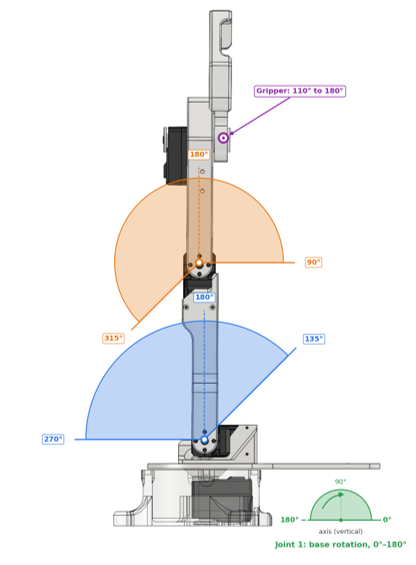

# PAINN-Arm
Operating procedures, codes and CADS for the four DOF robotic arm teaching aids

# Precautions
- Adhere to the given limits of the arm, going beyond the limits could damage the arm or result in injuries.
- Limits have been specified from the Arm's neutral position. 
- Run the arm at low speeds, low speeds result in lower errors and are less stressful on the arm.
- Ensure that the Z coordinate of the end effector do not become negative (ie. the end effector should not go below the base of the robot arm).
- Incase the arm behaves erratically TURN OFF POWER AND STEP AWAY.
- DO NOT TOUCH ANY EXPOSED WIRING.
- Do not operate the end effector for this course

# Joint Limits
|Joint No.|Range in Degrees|Range in Encoder Values|
|---------|----------------|-----------------------|
|1. (base)| 0-180 | 0-2048 |
|2. | 135-270 | 1536-3072 |
|3. | 90-315 | 1024-3584 |
|4. | 110 - 180| 1254-2048 |

# Link Lengths
- Please verify the link lengths yourself before planning any trajectory
- For the scope of this course ignore the end effector and treat it as an extension of link 3
- It may be helpful to treat the base height as zero (d1 = 0) to stop the arm from colliding with the base.

|Link No.|Length in mm|
|--------|------------|
|d1 (base)| 65.7|
|L2|136.5|
|L3|97.06|
|L4 (ee, fully extended|101.04|

